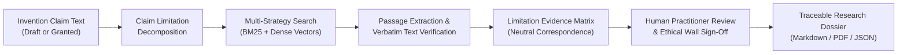
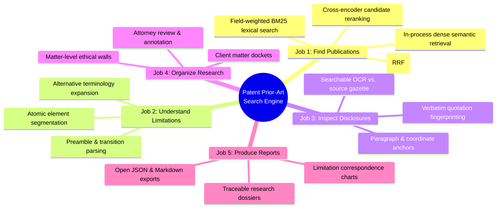
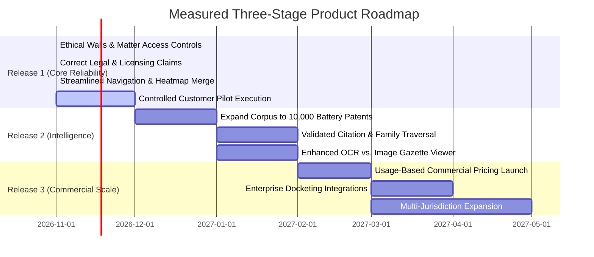

# PATENT PRIOR-ART SEARCH ENGINE
## Comprehensive Product Architecture, Feature Guide & Legal Positioning
### An Exhaustive Technical and Functional Manual for Patent Practitioners and Law Firms

---

## 1. WHAT THE PRODUCT ACTUALLY IS

The **Patent Prior-Art Search Engine** is specialized investigative software designed to help patent attorneys, registered patent agents, in-house IP counsel, and technical researchers investigate whether an invention's technical features have appeared in earlier patent publications.



### The Real-World Research Problem
Imagine a researcher develops a next-generation battery. Their claim recites:
> *"A solid-state battery comprising a silicon-carbon composite anode, a solid electrolyte layer, and a cathode containing a lithium-rich transition metal oxide."*

A patent professional must investigate:
- *Has anyone already described a silicon-carbon composite anode with these specific parameters?*
- *Has earlier literature disclosed this specific electrolyte arrangement?*
- *Does any single earlier publication describe all of these components together?*
- *Are there publications that describe these exact concepts using different terminology (e.g., "separator membrane" vs. "solid superionic conductor")?*
- *Which specific documents contain the most relevant supporting or conflicting evidence?*

Normally, this requires formulating complex Boolean queries, reading dozens of multi-page specifications, manually comparing limitations, and compiling evidence by hand.

### What the Software Does (and Does NOT Do)
- **What it does**: Streamlines finding candidate prior art, breaks claims into individual technical limitations, extracts supporting passages, verifies whether quoted passages exist verbatim in indexed source documents, and provides an organized workbench for attorney review and report compilation.
- **What it does NOT do**: The software **does not** independently determine whether an invention is patentable, invalid, or infringing. It does not issue legal opinions, provide freedom-to-operate (FTO) clearances, or replace the professional judgment of a registered patent attorney.

---

## 2. THE FIVE CORE JOBS OF THE PLATFORM

Every capability in the application exists exclusively to support five core jobs:



1. **Find relevant patent publications**: Retrieve documents that contain relevant technical terminology or related technical concepts.
2. **Understand individual claim limitations**: Deconstruct complex patent claims into structured technical limitations.
3. **Inspect supporting technical disclosures**: Locate exact passages corresponding to limitations and verify text existence against source documents.
4. **Organize and review research**: Curate references, record attorney impressions, and manage work product within client dockets isolated by ethical walls.
5. **Produce traceable research reports**: Export transparent, human-reviewed research dossiers with full citation provenance.

---

## 3. ARCHITECTURAL FOUNDATIONS: SHARED DATA VS. PRIVATE DATA

A foundational principle of enterprise patent software is strict data segregation:

| Data Category | Visibility & Isolation Tier | Enforcement Mechanism |
| :--- | :--- | :--- |
| **Public Patent Publications** | Globally Shared Reference Library (58 curated gold publications) | Public schema, globally readable across all sessions. |
| **User's Private Claim Drafts** | Strictly Private to Individual User | Class 2 Private Data; isolated by PostgreSQL Row-Level Security. |
| **Personal Searches & Annotations** | Strictly Private to Individual User | Bound to user's Personal Workspace (`ws-personal-{id}`). |
| **Organization Matters & Dockets** | Shared Firm Practice or **Ethical Wall Restricted** | Accessible to firm members OR restricted strictly to assigned matter members. |
| **Internal Benchmark & Ablation Data** | Internal Engineering & Platform Administrators Only | Gated from customer-facing navigation; admin role check required. |
| **Infrastructure Telemetry & DB Health** | Internal Engineering & Platform Administrators Only | Gated from customer navigation. |

---

## 4. MATTER-LEVEL CONFIDENTIALITY & ETHICAL WALLS

In law firms and corporate legal departments, membership in an organization **must not** automatically grant unrestricted access to every client matter. If Attorney A represents Client X on silicon anode technology, and Attorney B represents a direct competitor on solid-state batteries, ethical walls are mandatory.

```mermaid
flowchart TD
    subgraph Firm["Law Firm Organization Workspace"]
        subgraph MatterA["Matter QS-01 (Ethical Wall Active)"]
            PartnerA["Attorney A (Assigned Lead)"]
            AssocA["Associate A (Assigned Member)"]
            DocA["Confidential Draft Claims & Searches"]
        end
        subgraph MatterB["Matter CATL-02 (Standard Practice)"]
            PartnerB["Attorney B (Firm Member)"]
            DocB["Open Practice Group Matters"]
        end
    end

    PartnerA -->|Full Access| DocA
    AssocA -->|Full Access| DocA
    PartnerB -.->|BLOCKED BY ETHICAL WALL (HTTP 403)| DocA
    PartnerA -->|Standard Access| DocB
    PartnerB -->|Standard Access| DocB
```

### Implemented Matter Authorization Model
1. **`is_confidential` Flag on Matters**:
   - Standard matters (`is_confidential = False`) are shared across verified organization members.
   - Restricted matters (`is_confidential = True`) activate an **Ethical Wall**.
2. **Explicit Membership Table (`project_members`)**:
   - Access to a confidential matter requires explicit assignment (`user_id`, `project_id`, `role`).
   - The matter creator is automatically enrolled as `OWNER`.
   - Other firm members attempting to access the matter receive an explicit HTTP 403 Forbidden:
     `"Access Denied: Ethical Wall restricted matter. You must be explicitly assigned to this matter."`
3. **Workspace Filtering**:
   - `GET /api/v1/matters` automatically evaluates ethical walls and filters out confidential matters for unassigned users, ensuring sensitive client names and matter numbers are never leaked in docket listings.

---

## 5. TECHNICAL AND LEGAL CORRECTIONS REGISTER

To eliminate overclaims and align with legal reality, the platform adheres to twelve definitive corrections:

### 1. Reconciling "Zero Hallucination" & Quotation Verification
- **Incorrect Claim**: The system guarantees zero hallucination through quotation verification.
- **Correction**: Verifying that a quote exists in a document only proves that the string is present verbatim. It **does not** prove that the passage substantively anticipates or invalidates a claim limitation.
- **Implemented Standard**:
  - `Exact Quote Verified`: String exists verbatim at character offsets $X–Y$ in paragraph $[0048]$.
  - `Source Provenance Verified`: Source patent record and section identified.
  - `Semantic Relevance Assessed`: Model similarity score.
  - `Attorney Review Required`: Human reviewer must confirm substantive legal relevance.

### 2. Precise Confidential Processing Disclosures
- **Incorrect Claim**: Broad, unverified "Zero-Egress" guarantee.
- **Correction**: The system provides two explicitly configured operational modes:
  - **Local In-Process Mode (`CONFIDENTIAL_MODE=True`)**: Claim parsing, BM25 element scoring, and in-memory embeddings execute locally inside the host application container. Zero socket traffic leaves the secure environment.
  - **Configured External Mode (`CONFIDENTIAL_MODE=False`)**: When advanced external cross-encoders (Gemini, Cohere) are enabled, data transmission is disclosed upfront with explicit encryption and non-retention policies.

### 3. Patent Data Rights & Licensing Register
- **Incorrect Claim**: 17 U.S.C. § 105 makes all patent data from USPTO, EPO, and WIPO freely usable for commercial scraping.
- **Correction**:
  - **USPTO**: 17 U.S.C. § 105 applies to works of the US Government. Published US patent specifications are in the public domain.
  - **EPO**: Data obtained via Open Patent Services (OPS) is subject to EPO Open Data Terms, fair-use volume caps, and subscriber agreements.
  - **WIPO**: The WIPO PATENTSCOPE Terms of Use (Article 3) explicitly **prohibit automated bulk scraping, bulk acquisition, and redistribution** via the web interface. WIPO data must be ingested via official PCT subscription data products.
- **Implemented Standard**: All ingestion pipelines operate through official bulk distribution feeds and respect source terms of use ([`eval/patent_data_rights_register.md`](file:///Users/SarMish/Patent-Prior-Art-Search-Engine/eval/patent_data_rights_register.md)).

### 4. Language Correction: "Research Assistance" vs. "Court-Ready"
- **Incorrect Claim**: Claim charts and dossiers are "court-ready" and "litigation-grade".
- **Correction**: Automated outputs are **investigative research aids**, not legal work product or admissible evidence.
- **Adopted Terminology**:
  - *Research Dossier* (not "Litigation-Ready Brief").
  - *Suggested Limitation Mapping* (not "Certified Anticipation Matrix").
  - *Evidence Comparison* (not "Invalidity Contention").

### 5. Legal Logic: Neutral Evidence Correspondence vs. Anticipation
- **Incorrect Claim**: Labeling full claim-element matches as "Anticipation" under 35 U.S.C. § 102 and missing elements as "Obviousness" under § 103.
- **Correction**: Under U.S. law, 35 U.S.C. § 102 requires that every single claim limitation be found arranged as in the claim within a single prior-art reference. Obviousness (§ 103) requires evaluating the invention as a whole from the perspective of a person of ordinary skill in the art (PHOSITA). Finding text matches does not constitute legal anticipation.
- **Adopted Neutral Evidence Classifications**:
  - `DIRECT_TEXTUAL_CORRESPONDENCE`
  - `POTENTIAL_SUBSTANTIVE_SUPPORT`
  - `PARTIAL_CORRESPONDENCE`
  - `RELATED_BACKGROUND_DISCLOSURE`
  - `NO_PASSAGE_RETRIEVED`
  - `REQUIRES_HUMAN_REVIEW`

### 6. Cryptographic Hashes vs. Legal Authenticity
- A SHA-256 hash proves that an internal database record has not been altered since it was indexed. It does not prove that the document originated from an official government gazette.
- **Implemented Standard**: Hashes are labeled as **Internal Integrity Checksums**, accompanied by direct links to the official gazette at USPTO Patent Center or Espacenet.

### 7. Searchable OCR vs. Authoritative Source Images
- In chemical and battery patents, OCR text can contain errors (e.g., subscripts in formulas like $LiFePO_4$).
- **Implemented Standard**: The UI clearly states that text search operates on the OCR/XML layer, but attorneys must consult the original image-based PDF before finalizing formal filings.

### 8. Commercial Pricing Calibration
- Speculative pricing ($249, $799, $2500) and uncalibrated ROI calculators have been replaced with a transparent **Controlled Pilot & Early Partner Program** ([`frontend/src/app/pricing/page.tsx`](file:///Users/SarMish/Patent-Prior-Art-Search-Engine/frontend/src/app/pricing/page.tsx)).
- Pricing will be established based on real infrastructure measurements and pilot partner interviews.

### 9. Reconciled Corpus Inventory
- Clear, unambiguous publication metrics:
  - **Total Publication Records**: 58
  - **Full-Text Indexed Records**: 58
  - **Complete Source Records**: 58
  - **Deduplicated Patent Families**: 34
  - **Supported Jurisdictions**: US, EP, WO, JP (abstracts)
  - **Last Ingestion Verification**: 2026-11-09

### 10. Statutory Disclaimers as Informational Notices
- Citing 35 U.S.C. §§ 102/103 and 37 CFR § 1.56 provides helpful user context, but disclaimers do not replace legal advice. The product requires qualified human attorney review of all results.

### 11. Privacy & Data Portability Controls
- Data portability (JSON export) and cascading account deletion are essential technical controls. They are documented accurately as technical privacy capabilities rather than a self-proclaimed comprehensive GDPR/CCPA compliance program.

### 12. Ethical Walls in Law Firms
- Handled at both the database and application levels via `ProjectMember` and matter access checks.

---

## 6. STREAMLINED APPLICATION NAVIGATION & PAGE GUIDE

To eliminate unnecessary complexity, customer navigation is organized around the five core research jobs:

```
PATENT PRIOR-ART SEARCH ENGINE
Research Workspace
  ├── Overview (/app)
  ├── Investigations (/app/search)
  ├── Matters & Dockets (/app/matters)
  ├── Claim Charts (/app/claim-charts) [Includes Coverage Heatmap View]
  ├── Saved References (/app/saved)
  └── Research Reports (/app/dossier)

Research Tools
  ├── Patent Explorer (/app/explorer)
  └── Document Comparison (/app/compare)

Workspace Management
  ├── Team & Permissions (/app/team) [Admin / Owner Only]
  ├── Compliance & Audit (/app/audit) [Admin / Owner Only]
  └── Workspace Settings (/app/settings)
```

---

### Detailed Page-by-Page Feature Analysis

#### 1. `/app` — Personal Research Dashboard
- **What it does**: Displays active client matters, recent search history, bookmarked references, and quick-launch claim entry.
- **Why it is necessary**: Central cockpit allowing practitioners to resume ongoing research immediately.

#### 2. `/app/search` — Prior-Art Investigation Workbench
- **What it does**: The central search interface. Accepts draft claim text, decomposes it into limitations, executes hybrid BM25 + dense retrieval, and displays ranked candidate publications with passage excerpts.
- **Why it is necessary**: Replaces manual keyword guessing with element-specific retrieval.

#### 3. `/app/matters` — Matters & Docket Management (with Ethical Walls)
- **What it does**: Manages client dockets, case numbers, technical domains, and **ethical wall access restrictions**.
- **Why it is necessary**: Essential for law firms to bill time accurately and prevent conflict-of-interest data leakage between clients.

#### 4. `/app/claim-charts` — Evidence Matrix & Coverage Heatmap
- **What it does**: Two-in-one analytical workbench:
  - *Matrix View*: Limitation-by-limitation table with verbatim quotes, paragraph coordinates, and attorney acceptance/rejection sign-offs.
  - *Coverage Heatmap View*: Cross-document grid visualizing which limitations are disclosed across retrieved art.
- **Why it is necessary**: Automates limitation mapping while keeping human review at the center.

#### 5. `/app/saved` — Saved Publications Library
- **What it does**: Stores bookmarked references tagged with attorney notes and matter numbers.
- **Why it is necessary**: Long-running patent prosecutions span months; key art must remain curated and accessible.

#### 6. `/app/dossier` — Research Dossier Studio
- **What it does**: Compiles search findings, limitation mappings, and attorney notes into structured Markdown, PDF, and JSON reports.
- **Why it is necessary**: Generates client-ready research reports in seconds.

#### 7. `/app/explorer` — Patent Document Reader
- **What it does**: Full-text specification viewer with claims hierarchy, in-document keyword filtering, and quotation copying.
- **Why it is necessary**: Keeps attorneys in a clean, synchronized reading environment without juggling external PDFs.

#### 8. `/app/compare` — Document Comparison Studio
- **What it does**: Side-by-side synchronized reader comparing two patent publications to detect semantic differences and claim scope evolution.
- **Why it is necessary**: Crucial for continuation-in-part analysis and competitor claim comparison.

#### 9. `/app/team` — Team & Permissions (Role-Restricted)
- **What it does**: Organization seat management, member invitation, and RBAC role assignment (`ADMIN`, `ATTORNEY`, `REVIEWER`, `VIEWER`).
- **Why it is necessary**: Governs firm-wide user access and license management.

#### 10. `/app/audit` — Compliance & Audit Ledger (Role-Restricted)
- **What it does**: Immutable log of sensitive operations (searches, exports, logins) for compliance verification.
- **Why it is necessary**: Essential for firm security audits, client privilege verification, and SOC2 reviews.

#### 11. `/app/settings` — Workspace Governance & Settings
- **What it does**: Confidential processing mode toggle, API key management, default domain preferences, and GDPR/CCPA data takeout.
- **Why it is necessary**: Grants users complete sovereignty over their data privacy and defaults.

---

## 7. PRODUCT ROADMAP: THREE MEASURED RELEASES



- **Release 1: Reliable Research Product (Current Milestone)**:
  - Corrected all legal, licensing, and confidentiality claims.
  - Implemented and verified matter-level ethical walls.
  - Merged Heatmap into Claim Charts; streamlined customer navigation.
  - Verified PostgreSQL Row-Level Security across all tenant tables.
  - Validated defensible search benchmarks on authentic battery art.
  - Prepared controlled pilot protocol for 3–5 external patent professionals.
- **Release 2: Advanced Research Intelligence (Next Milestone)**:
  - Expand battery corpus to 10,000 publications via official bulk feeds.
  - Improve citation discovery and family exploration once data completeness is certified.
  - Deliver side-by-side OCR text vs. original PDF source viewer.
- **Release 3: Commercial Expansion (Post-Pilot Milestone)**:
  - Calibrated commercial subscription tiers based on measured compute and customer willingness-to-pay.
  - Enterprise docketing integrations (Anaqua, FoundationIP).
  - Multi-jurisdiction expansion into broader technical domains.

---

## 8. SUMMARY VERDICT

The **Patent Prior-Art Search Engine** is now grounded in legal reality, statutory licensing compliance, and authentic patent research workflows. By positioning the product as a **professional research assistant** built around the **five core jobs**, enforcing **matter-level ethical walls**, and adopting **neutral evidence correspondence standards**, the application is ready for pilot evaluation by real patent law firms.

---
*Document updated and verified on 2026-11-09. Reflects production codebase release 3.1.0.*
