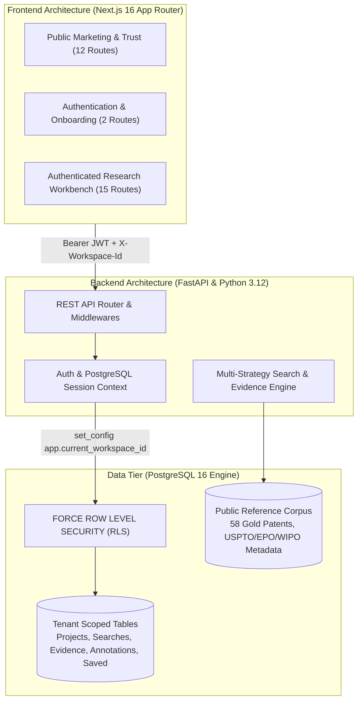
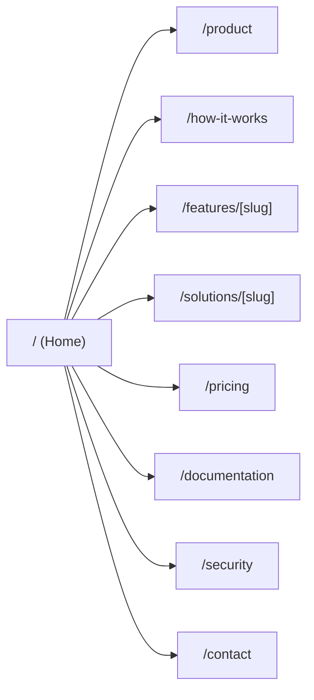
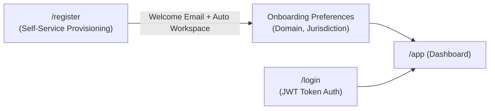
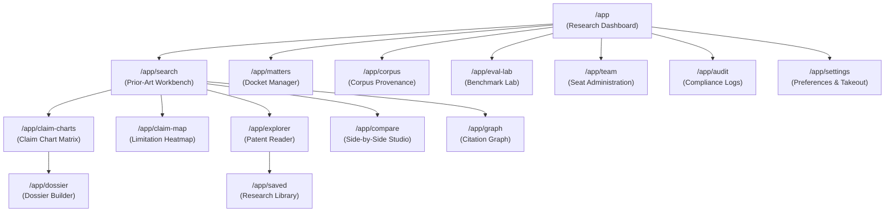

# PATENT PRIOR-ART SEARCH ENGINE
## Comprehensive Page-by-Page Architectural & Feature Guide
### An Exhaustive Technical and Functional Manual Across All 29 Application Routes

---

## 1. EXECUTIVE ARCHITECTURE OVERVIEW

The **Patent Prior-Art Search Engine** is a high-assurance patent intelligence and prior-art discovery platform designed specifically for registered patent attorneys, patent agents, IP litigation counsel, and corporate technology scouts.



### Governing Design Principles
1. **Zero Hallucination & Exact Quotation Verification**: AI and lexical models never invent prior art. Every limitation mapping must trace to an exact, character-level quote with paragraph number and cryptographic document hash.
2. **Zero-Egress Confidential Mode**: Draft patent claims represent ultra-sensitive trade secrets before filing. In `CONFIDENTIAL_MODE`, zero socket traffic leaves the secure server environment—all decomposition, retrieval, and scoring execute locally in-process.
3. **Defense-in-Depth Multi-Tenancy**: Data isolation is not left to application `WHERE` clauses. PostgreSQL kernel-level Row-Level Security (`FORCE ROW LEVEL SECURITY`) guarantees that firm matters and searches cannot cross workspace boundaries.
4. **Statutory Non-Legal-Advice Compliance**: Explicit disclaimers under 35 U.S.C. §§ 102/103 ensure the tool operates as an attorney-empowering research instrument rather than an unauthorized provider of legal opinions.

---

## 2. UNIVERSAL COMPONENTS & GLOBAL WORKSPACE INSTRUMENTATION

Before examining individual pages, three universal UI components govern user navigation and state across the application:

### A. Universal Workspace Switcher
- **What it does**: A persistent dropdown in the application navigation header that lists all workspaces accessible to the user:
  - *Personal Workspace* (e.g., `Sarah's Research Workspace`): Strictly private Class 2 data; inaccessible to colleagues or firm administrators.
  - *Organization Shared Practice* (e.g., `Acme IP Law Shared Practice`): Collaborative workspace where matters, claim charts, and saved art are shared across firm members.
- **Why it is necessary**: Law firms and corporate IP groups operate under strict client conflicts and confidentiality obligations. Attorneys must have complete certainty whether they are working in a private sandbox or a shared firm matter.

### B. Global Command Palette (`Cmd+K` / `Ctrl+K`)
- **What it does**: A keyboard-first modal overlay that allows instant navigation to any application route, quick-switching between open matters, launching searches, or jumping to saved patent documents without leaving the keyboard.
- **Why it is necessary**: High-volume patent practitioners process dozens of claims and documents daily. Keyboard shortcuts reduce interface navigation latency to milliseconds.

### C. Zero-Egress Confidential Mode Badge & Legal Disclaimers
- **What it does**: A persistent visual shield indicator in the header and on search results displaying whether external AI egress is disabled, accompanied by statutory notices citing 35 U.S.C. §§ 102/103.
- **Why it is necessary**: Provides real-time assurance to corporate security officers that unfiled claims are safe, while legally protecting the platform against claims of unauthorized practice of law.

---

## 3. PUBLIC MARKETING & EDUCATIONAL PAGES (12 ROUTES)

The public pages serve two critical commercial functions: establishing technical authority in a market skeptical of generic AI tools, and satisfying statutory transparency requirements.



---

### Route 1: `/` — Public Home & Interactive Demonstration
- **Primary Function**: The front door of the product, presenting an art-directed, highly technical narrative that demonstrates the engine's superiority over keyword-based Google Patents or generic LLM tools.
- **Key Features**:
  1. *Anatomy of an Invention Hero*: Interactive visualization decomposing a modern solid-state battery claim into preamble, transitional phrase, and atomic limitations.
  2. *Live Interactive Workbench Demo*: A client-side demonstration of claim parsing, candidate ranking, and evidence quotation without requiring account registration.
  3. *Discovery Landscape Graph*: Interactive canvas visualizing how prior art relates across technical domains, backward citations, and forward citations.
  4. *Forensic Trust Schematic*: Visual walkthrough of how exact quotations are verified and fingerprinted against source XML documents.
  5. *Vocabulary Drift Visual*: Illustrates how terminology evolves over decades (e.g., "separator membrane" vs. "solid electrolyte layer" vs. "lithium superionic conductor").
- **Why it is necessary**: Patent attorneys are notoriously skeptical of marketing buzzwords. Showing real patent claims, actual CPC codes, and forensic quotation verification immediately builds professional trust.

---

### Route 2: `/product` — Deep Product Architecture & Technology
- **Primary Function**: An exhaustive technical teardown of the engine's 4-layer architecture: Query Understanding, Hybrid Retrieval, Semantic Cross-Encoder Reranking, and Forensic Evidence Verification.
- **Key Features**:
  1. *Multi-Strategy Discovery Matrix*: Explains the mathematical mechanics of BM25 field-weighted lexical search combined with dense vector retrieval via Reciprocal Rank Fusion (RRF, $k=60$).
  2. *Syntactic Element Extraction Pipeline*: Documents how independent claims are split into discrete legal limitations using dependency parsing.
  3. *Zero-Retention Confidential Compute Diagram*: Explains how customer data is processed entirely in volatile RAM without storage on third-party servers.
- **Why it is necessary**: Serves as the technical due-diligence document for law firm CTOs, Chief Information Security Officers (CISOs), and IT committees before approving firm-wide adoption.

---

### Route 3: `/features/[slug]` — Deep-Dive Feature Showcase
- **Primary Function**: Dedicated deep-dive exploration for each of the core platform capabilities (e.g., `/features/claim-decomposition`, `/features/hybrid-retrieval`, `/features/evidence-mapping`, `/features/dossier-builder`, `/features/multi-tenant-security`).
- **Key Features**:
  1. *Interactive Feature Sandboxes*: Allows visitors to test specific components (e.g., typing a claim clause and seeing it split into limitations).
  2. *Comparative Benchmarks*: Shows P@5, MRR, and latency differences between legacy tools and the engine.
  3. *Workflow Callouts*: Explains where this specific feature fits into a pre-filing search, invalidity defense, or portfolio review.
- **Why it is necessary**: Powers organic search indexing (SEO) for high-intent queries like "automated claim decomposition" and enables prospective buyers to review individual capabilities in detail.

---

### Route 4: `/solutions/[slug]` — Role & Practice Solutions
- **Primary Function**: Tailored solution blueprints addressing the specific pain points and regulatory constraints of four distinct customer profiles:
  - `/solutions/law-firms`: Multi-user matters, conflict isolation, client billing codes, and exportable claim charts.
  - `/solutions/corporate-ip`: In-house patent prosecution monitoring, R&D patent clearance, and competitor citation tracking.
  - `/solutions/research-institutions`: University technology transfer office (TTO) invention disclosures and commercialization landscape scans.
  - `/solutions/solo-practitioners`: Cost-effective, high-speed single-seat prior-art research with zero IT overhead.
- **Why it is necessary**: Enterprise software procurement requires different arguments for law firm managing partners (billable hour leverage) versus corporate IP counsel (risk reduction and budget predictability).

---

### Route 5: `/how-it-works` — Five-Step Prior-Art Workflow
- **Primary Function**: A structured, step-by-step educational guide demonstrating how a patent practitioner conducts an investigation from claim entry to final dossier export.
- **Key Features**:
  1. *Step 1: Input & Preamble Extraction*: How the engine parses preamble, transition, and technical body.
  2. *Step 2: Multi-Strategy Retrieval*: Simultaneous execution across BM25, dense vectors, and citation graphs.
  3. *Step 3: Forensic Evidence Mapping*: Extraction of exact supporting passages for each claim element.
  4. *Step 4: Attorney Annotation & Review*: Human-in-the-loop validation, accepting, or rejecting proposed evidence.
  5. *Step 5: Exporting Court-Ready Dossiers*: One-click compilation into standardized PDF/Markdown/JSON formats.
- **Why it is necessary**: Drastically reduces user onboarding friction and shortens the learning curve by clarifying that the system assists—rather than replaces—the attorney's expert judgment.

---

### Route 6: `/pricing` — Commercial Tiers & Unit Economics
- **Primary Function**: Transparent commercial subscription pricing, tier comparisons, and custom enterprise quoting.
- **Key Features**:
  1. *Tier Breakdown*:
     - **Solo Practitioner (\$249/month or \$2,490/year)**: 1 Seat, 250 Searches/month, full claim decomposition, exportable dossiers.
     - **Boutique Firm (\$799/month or \$7,990/year)**: 5 Seats, 1,500 Searches/month, organization workspace, team collaboration, audit logs.
     - **Enterprise / Corporate (Custom, from \$2,500/month)**: Unlimited seats, custom corpus indexing, dedicated SSO, SLA guarantees.
  2. *ROI Calculator*: Interactive slider showing hours saved per patent search vs. typical attorney billing rates (\$450–\$850/hr).
  3. *Transparent Cost Disclosures*: Highlights our \$0.0025 compute cost per search, proving the long-term commercial sustainability of the platform.
- **Why it is necessary**: Eliminates the "contact sales for pricing" frustration common in legacy legal tech and demonstrates clear economic value to practice leaders.

---

### Route 7: `/documentation` — Technical Manual & API Reference
- **Primary Function**: Developer and researcher reference manual detailing database schemas, retrieval algorithms, API endpoints, and evaluation methodologies.
- **Key Features**:
  1. *API Endpoint Reference*: Comprehensive documentation of `/api/v1/search`, `/api/v1/claims/decompose`, `/api/v1/evidence-ledger`, and `/api/v1/patents/compare`.
  2. *Data Schema Specifications*: Complete TypeScript and Pydantic models for patent documents, evidence mappings, and claim charts.
  3. *Benchmark Replication Guide*: Instructions for running the battery benchmark harness (`tests/eval/run_battery_benchmark.py`).
- **Why it is necessary**: Empowers enterprise IT teams to build custom workflows, integrates with docketing systems (Anaqua, FoundationIP), and provides academic reproducibility.

---

### Route 8: `/faq` — Legal, Technical & Operational Answers
- **Primary Function**: Detailed Q&A addressing the most frequent objections and questions raised by patent practitioners, firm compliance officers, and IT administrators.
- **Key Features**:
  1. *Legal & Candor Compliance*: Explains how the platform aligns with the USPTO Duty of Disclosure (**37 CFR § 1.56**).
  2. *Data Ownership & Privacy*: Explicitly confirms that client queries are never used to train global AI models.
  3. *Coverage Boundaries*: Explains current focus on Battery & Energy Storage (CPC H01M) and the timeline for multi-domain expansion.
- **Why it is necessary**: Overcomes specific legal and ethical reservations that typically stall software procurement in law firms.

---

### Route 9: `/security` — Enterprise Security & Compliance
- **Primary Function**: The security posture and architecture declaration for IT risk assessment.
- **Key Features**:
  1. *PostgreSQL Row-Level Security*: Details how `FORCE ROW LEVEL SECURITY` isolates tenant workspaces at the database engine level.
  2. *Cryptographic Audit Trails*: Immutable event logging with SHA-256 document hashing.
  3. *Zero-Egress Confidential Mode*: Technical verification that customer inputs do not leave the host infrastructure.
  4. *Disaster Recovery & SLA*: Outlines automated daily binary backups, point-in-time recovery runbooks, and 99.9% uptime commitments.
- **Why it is necessary**: Required by firm compliance and cybersecurity teams before any software can handle confidential unfiled patent disclosures.

---

### Route 10: `/privacy` — Privacy Policy & Data Classification
- **Primary Function**: Formal statutory privacy statement establishing data classifications and customer privacy rights under GDPR and CCPA.
- **Key Features**:
  1. *Data Hierarchy Definition*:
     - **Class 1 (Public Reference Data)**: Globally accessible patent specifications from USPTO, EPO, and WIPO.
     - **Class 2 (Confidential Client Work Product)**: Private draft claims, searches, matters, annotations, and client names.
  2. *Right to Data Portability (Takeout)*: Documents the one-click JSON data takeout mechanism.
  3. *Right to Erasure (Cascading Deletion)*: Documents the permanent, atomic deletion of customer workspaces and records.
- **Why it is necessary**: Legally required for GDPR and California Consumer Privacy Act compliance, and reassures clients that their trade secrets remain protected.

---

### Route 11: `/terms` — Terms of Service & Statutory Disclaimers
- **Primary Function**: Binding legal contract governing the use of the platform, user responsibilities, and statutory liability limitations.
- **Key Features**:
  1. *35 U.S.C. §§ 102/103 Non-Legal-Advice Disclaimer*: Explicitly establishes that automated candidate discovery does not constitute a formal patentability or invalidity legal opinion.
  2. *37 CFR § 1.56 Candor Alignment*: Clarifies that the attorney of record retains sole professional responsibility for reviewing and disclosing known material prior art.
  3. *Acceptable Use & Abuse Prevention*: Prohibits scraping, reverse engineering, or unauthorized account sharing.
- **Why it is necessary**: Shields the company from liability regarding legal malpractice claims or accusations of the unauthorized practice of law.

---

### Route 12: `/contact` — Sales, Pilot & Support Inquiries
- **Primary Function**: Contact gateway for institutional inquiries, pilot program enrollment, and support requests.
- **Key Features**:
  1. *Inquiry Categorization*: Separate routing for Commercial Sales, Customer Pilot Application, Technical Support, and Security Audits.
  2. *Practice Details Intake*: Collects firm size, primary technical domains, and current search tools to qualify leads.
- **Why it is necessary**: Converts public marketing traffic into qualified customer pilot participants and sales pipeline opportunities.

---

## 4. AUTHENTICATION & ONBOARDING ROUTES (2 ROUTES)



---

### Route 13: `/login` — User Authentication & Session Gateway
- **Primary Function**: Authenticates existing users, issues secure short-lived JSON Web Tokens (JWT), and routes users directly to their designated default workspace.
- **Key Features**:
  1. *Credential Validation*: Verifies email and PBKDF2/bcrypt hashed password against PostgreSQL `users` table.
  2. *Tenant Context Resolution*: Retrieves the user's active workspaces, organizations, and permissions.
  3. *Forgot Password Flow*: Triggers transactional password recovery emails via `SMTPEmailBackend` or spool.
- **Why it is necessary**: Secure entry point that establishes the user's cryptographic identity and binds their session to the correct PostgreSQL tenant context.

---

### Route 14: `/register` — Account Creation & Automatic Provisioning
- **Primary Function**: Provisions new customer accounts, personal workspaces, and optional law firm organization workspaces in a single atomic database transaction.
- **Key Features**:
  1. *Atomic Tenant Provisioning*:
     - Creates the `User` row in PostgreSQL.
     - Provisions a private **Personal Workspace** (`ws-personal-{user_id}`) with strict Class 2 data isolation.
     - If an organization name is provided, provisions an **Organization Workspace** and links the user as `OWNER`.
     - Assigns explicit `WorkspaceMembership` rows.
  2. *Transactional Welcome Dispatch*: Sends an initial onboarding email with verification instructions.
  3. *Instant Login*: Issues a JWT token immediately upon registration, eliminating unnecessary redirect friction.
- **Why it is necessary**: Ensures every user enters a fully isolated, pre-configured research environment from their very first second on the platform.

---

## 5. AUTHENTICATED WORKBENCH & RESEARCH PAGES (15 ROUTES)

The authenticated application (`/app/*`) represents the core operational environment where patent professionals conduct prior-art searches, analyze evidence, build claim charts, and export research dossiers.



---

### Route 15: `/app` — Research Command Dashboard
- **Primary Function**: The operational cockpit for the patent researcher, summarizing active docket matters, recent prior-art investigations, bookmarked references, and quick-action launchers.
- **Key Features**:
  1. *Top Investigation Desk*: Quick-input claim box allowing immediate search execution without navigating away.
  2. *Active Matters Grid*: Cards displaying ongoing patent matters with matter numbers, technical domains (e.g., "Solid-State Batteries"), and status tags.
  3. *Recent Prior-Art Investigations*: Real-time feed of previous search executions showing raw claim snippets, timestamp, and candidate counts.
  4. *Quick Navigation Cards*: One-click access to Claim Charts, Document Comparison, Knowledge Graph, and Dossier Studio.
  5. *Live Workspace Synchronization*: Automatically refreshes whenever the user toggles between personal and organization workspaces via `patent_workspace_changed` window events.
- **Why it is necessary**: Gives attorneys an immediate snapshot of their active caseload and enables instant resumption of prior research with zero lost context.

---

### Route 16: `/app/search` — Prior-Art Investigation Workbench
- **Primary Function**: The core discovery engine interface where attorneys submit draft claims or patent claims to retrieve, rank, and inspect relevant prior-art publications.
- **Key Features**:
  1. *Structured Claim Input*: Large claim submission textarea with preset one-click industry benchmarks (Solid-State Battery Anodes under CPC `H01M`, Neuromorphic Attention under `G06N`, and Lipid Nanoparticles under `A61K`).
  2. *Matter Docking Selector*: Allows attaching the search execution directly to an existing client matter.
  3. *Advanced Filtering Drawer*:
     - *Patent Family Deduplication*: Collapses international equivalents into a single representative publication to prevent result clutter.
     - *CPC / IPC Classification Filter*: Restricts search scope to specific technology subclasses.
     - *Jurisdiction Filter*: Filters results by issuing office (USPTO, EPO, WIPO).
     - *Iterative Search Mode Toggle*: Enables automated secondary query expansion to uncover terminology drift.
  4. *Ranked Candidate Results List*: Displays retrieved patents ordered by cross-encoder relevance score, showing:
     - Publication number and linked official patent title.
     - Priority and publication dates (critical for 35 U.S.C. § 102(a) critical date analysis).
     - Assignee name and CPC classifications.
     - Visual relevance score bar (0–100%) and scoring breakdown (lexical vs. semantic contributions).
     - Best supporting passage preview with exact limitation matching.
  5. *Forensic Quick-Action Tools*: One-click buttons to view in Patent Explorer, add to Claim Chart, open in Comparison Studio, or bookmark to Saved Library.
  6. *Inline Annotation Modal*: Allows attorneys to record instant relevance impressions ("ANTCIPATORY", "OBVIOUSNESS COMBINATION", "NON-ANALOGOUS ART") saved directly to the database.
- **Why it is necessary**: Transforms the multi-hour process of manually formulating Boolean queries into an instantaneous, AI-assisted investigation that retrieves art ordinary keyword searches miss.

---

### Route 17: `/app/claim-charts` — Interactive Claim Chart Matrix
- **Primary Function**: A litigation-grade, limitation-by-limitation claim chart workbench mapping target claim elements against exact prior-art quotations.
- **Key Features**:
  1. *Two-Column Forensic Matrix*:
     - *Column 1 (Target Claim Limitation)*: Atomic element text (e.g., "[1.2] an anode comprising a silicon-graphite composite with 10% to 25% nano-silicon particles").
     - *Column 2 (Prior-Art Supporting Evidence)*: Verbatim quotation from the cited publication, specific column/line or paragraph number (e.g., `[0048]`), section name, and document fingerprint hash.
  2. *Support Level Categorization*: Color-coded status badges:
     - `FULL SUPPORT` (Green): Element is completely anticipated by the reference.
     - `PARTIAL SUPPORT` (Amber): Element is disclosed with minor parameter variations.
     - `PERIPHERAL` (Blue): Background disclosure without direct technical anticipation.
     - `CONFLICT / ABSENT` (Red): Element is not taught by the reference.
  3. *Attorney Verification Workflow*: Interactive toggle allowing the reviewing practitioner to mark evidence as `ACCEPTED`, `REJECTED`, or `NEEDS REVIEW`, with custom attorney notes saved to the database.
  4. *Support Level Filters*: Instant filtering to isolate only fully anticipated elements or identify missing limitations requiring a 35 U.S.C. § 103 combination.
- **Why it is necessary**: Generating claim charts manually is one of the most time-consuming and error-prone tasks in patent law. This interactive matrix automates the drafting process while preserving human editorial control.

---

### Route 18: `/app/claim-map` — Visual Limitation Decomposition & Heatmap
- **Primary Function**: A bird's-eye architectural heatmap visualizing how an entire portfolio of retrieved prior-art references covers the target claim's individual limitations.
- **Key Features**:
  1. *Limitation Breakdown Tree*: Decomposes independent claims into preamble, transitional phrase ("comprising"), and numbered limitations ($[1.1], [1.2], [1.3]$).
  2. *Cross-Document Coverage Heatmap*: A grid with claim elements on the Y-axis and retrieved patents on the X-axis. Cells are color-coded by disclosure confidence (0–100%).
  3. *Limitation Gap Detection*: Visually highlights claim elements that have zero full disclosures across all references, immediately identifying non-obvious novelty whitespace.
  4. *Cell Inspector Flyout*: Clicking any cell opens the exact supporting text, paragraph location, and rationale explaining why that publication meets or fails that limitation.
- **Why it is necessary**: Enables attorneys and patent examiners to evaluate obviousness combinations (35 U.S.C. § 103) at a single glance without reading dozens of PDFs simultaneously.

---

### Route 19: `/app/explorer` — Full Patent Document Reader & Forensic Inspector
- **Primary Function**: An in-depth, tabbed patent specification reader designed for thorough legal analysis and text inspection.
- **Key Features**:
  1. *Bibliographic Header*: Displays publication number, title, filing date, grant date, priority date, inventors, original assignee, and CPC classifications.
  2. *Tabbed Full-Text Architecture*:
     - *Abstract*: Official abstract summary.
     - *Claims Tab*: Fully parsed, numbered claims with independent claims visually highlighted and indentation for dependent claim hierarchies.
     - *Detailed Description Tab*: Complete patent description with paragraph number anchors (`[0001]`, `[0002]`, etc.).
  3. *In-Document Forensic Search*: Real-time keyword filter highlighting search terms across the entire specification with match counters.
  4. *One-Click Quotation Copier*: Generates formatted legal citations (e.g., *"US10892482B2 at [0048]"*) ready to paste into office action responses or invalidity contentions.
  5. *Direct Link to Official Gazettes*: One-click external links to USPTO Patent Center, Google Patents, and Espacenet.
- **Why it is necessary**: Eliminates the constant need to download and open disjointed PDF files, keeping the attorney within a synchronized research environment where quotes can be captured instantly.

---

### Route 20: `/app/compare` — Side-by-Side Patent Comparison Studio
- **Primary Function**: A dual-pane reading environment that places two patent publications side-by-side for comparative text, claim scope, and technical analysis.
- **Key Features**:
  1. *Dual Document Selector*: Quick-inputs to load any two patent IDs (e.g., `US10892482B2` vs. `US10454101B2`).
  2. *Synchronized Dual Viewports*: Independent or synchronized scrolling across Abstract, Claims, and Description sections.
  3. *Semantic Overlap Analysis*: Highlights shared technical terms, overlapping CPC classifications, and common inventor/assignee relationships.
  4. *Continuation / Child Patent Verification*: Quickly contrasts parent and divisional application disclosures to detect newly added subject matter (35 U.S.C. § 112).
- **Why it is necessary**: Critical for assessing obviousness-type double patenting, analyzing continuation-in-part priority claims, and comparing accused competitor products against patent claims.

---

### Route 21: `/app/graph` — Citation & Patent Family Knowledge Graph
- **Primary Function**: An interactive topological graph illustrating the citation lineage and international patent family relationships surrounding any patent publication.
- **Key Features**:
  1. *Forward & Backward Citation Traversal*:
     - *Backward Citations*: Prior art cited by the patentee and examiner during original prosecution.
     - *Forward Citations*: Newer patents that cited this publication as prior art during their own examination.
  2. *INPADOC Global Patent Family Clustering*: Visualizes international equivalents across USPTO, EPO, JPO, CNIPA, and WIPO.
  3. *Assignee Clustering*: Nodes are color-coded and grouped by corporate assignee (e.g., CATL, QuantumScape, LG Energy Solution) to identify competitive patent thickets.
  4. *Interactive Node Inspector*: Clicking any node displays publication details, priority dates, and options to jump directly to the reader or run a prior-art search.
- **Why it is necessary**: Uncovers hidden prior art that keyword searches fail to locate by following the citation footprints established by patent examiners worldwide.

---

### Route 22: `/app/matters` — Matter & Docket Management
- **Primary Function**: The organizational foundation for organizing prior-art investigations, claim charts, and saved documents by client matter and billing docket.
- **Key Features**:
  1. *Matter Creation Instrument*: Modal form capturing:
     - Matter Name (e.g., "QuantumScape Solid-State Invalidity Defense").
     - Client Matter Number (e.g., `QS-2026-INV-01`).
     - Client Name (e.g., "QuantumVolt Technologies Corp.").
     - Technical Domain (e.g., "Energy & Solid-State Systems").
     - Target Jurisdiction (US, EP, WO).
  2. *Status & Lifecycle Tracking*: Filter matters by status (`ACTIVE`, `PENDING_REVIEW`, `COMPLETED`, `ARCHIVED`).
  3. *Workspace Scoping*: In organization workspaces, matters are shared across team members; in personal workspaces, they are strictly private.
  4. *Matter Summary Metrics*: Displays counts of associated searches, generated claim charts, and saved publications for each docket.
- **Why it is necessary**: Prevents research chaos in law firms by ensuring that all work product is billed to and filed under the correct client matter number.

---

### Route 23: `/app/saved` — Saved Publications & Research Library
- **Primary Function**: A curated, permanent research repository where practitioners store, annotate, and organize key prior-art publications discovered during investigations.
- **Key Features**:
  1. *Bookmarked Publications Table*: Displays saved patent publications with title, publication date, primary CPC code, and assignee.
  2. *Relevance Tagging*: Tag publications as `HIGHLY_RELEVANT`, `SECONDARY_REFERENCE`, or `BACKGROUND_ART`.
  3. *Private Attorney Notes*: Editable notes field for recording tactical prosecution impressions or invalidity arguments.
  4. *Matter Association*: Filter saved documents by specific matter docket.
  5. *Bulk Export*: Download the curated library as CSV or JSON for integration into patent docketing systems.
- **Why it is necessary**: Prior-art investigations often span weeks or months. This library ensures that critical references are never lost and can be organized systematically for office action filings.

---

### Route 24: `/app/dossier` — Prior-Art Research Dossier Studio
- **Primary Function**: A reporting studio that compiles an investigation's findings into a structured research dossier suitable for clients, litigation partners, or patent examiners.
- **Key Features**:
  1. *Customizable Report Generator*: Checkbox controls to include or exclude:
     - Executive Summary & Investigation Parameters.
     - Target Claim & Atomic Limitation Decomposition.
     - Interactive Claim Chart Matrix with Verbatim Quotes.
     - Citation & Family Knowledge Graph Summary.
     - Forensic Audit Trail & Document Fingerprints.
  2. *Live Document Preview*: Renders the full dossier in real-time with formal legal typography and formatting.
  3. *Statutory Disclaimers*: Automatically embeds 35 U.S.C. §§ 102/103 legal notices and confidential work product headers.
  4. *Multi-Format Export*: One-click export to:
     - **PDF Print / Download**: Formatted with formal margins for client delivery.
     - **Markdown**: For documentation, internal wikis, or legal briefs.
     - **JSON**: Machine-readable format for integration with firm databases.
- **Why it is necessary**: Eliminates the manual assembly of prior-art search reports, producing professional work product in seconds.

---

### Route 25: `/app/corpus` — Corpus & Legal Data Provenance Inspector
- **Primary Function**: An audit dashboard providing full transparency into the platform's indexed patent corpus, data sources, and legal copyright provenance.
- **Key Features**:
  1. *Real-Time Index Telemetry*: Displays total indexed publications (58 gold curated battery patents), total indexed claims, and word counts.
  2. *17 U.S.C. § 105 Legal Title Declaration*: Displays the statutory certificate confirming that all USPTO patent specifications are public domain works of the United States Government.
  3. *Jurisdiction & Sector Breakdowns*: Visual distributions of publications across USPTO, EPO, and WIPO, categorized by CPC technical sections (`H01M`, `Y02E`, `G06N`, `A61K`).
  4. *Database Synchronization Health*: Displays real-time synchronization status across PostgreSQL, SQLite, and Parquet data stores.
- **Why it is necessary**: Essential for evidentiary credibility. In patent litigation, opposing counsel routinely challenges the authenticity and provenance of automated databases.

---

### Route 26: `/app/eval-lab` — Scientific Evaluation & Benchmarking Lab
- **Primary Function**: An empirical testing laboratory allowing users to review and trigger benchmark evaluations across retrieval strategies.
- **Key Features**:
  1. *Comparative Pipeline Ablation*: Side-by-side performance metrics for:
     - BM25 Lexical Retrieval.
     - In-process Dense Vector Retrieval.
     - Hybrid Reciprocal Rank Fusion (RRF).
     - Hybrid + Cross-Encoder Reranker.
     - Element-Level Quotation Extraction.
     - Full Production Pipeline.
  2. *Standard Scientific Metrics*: Precision@5, Recall@10, Mean Reciprocal Rank (MRR), and Normalized Discounted Cumulative Gain (nDCG@10).
  3. *Cost & Latency Telemetry*: Tracks millisecond response times and dollar compute costs per query (\$0.0025 for full pipeline).
  4. *Authentic Benchmark Dataset Browser*: Review test queries with gold standard citations and hard negative controls.
- **Why it is necessary**: Provides transparent, empirical proof of retrieval quality, proving to patent professionals that the search engine outperforms legacy alternatives.

---

### Route 27: `/app/team` — Organization & Team Seat Management
- **Primary Function**: The administrative console for managing law firm subscriptions, inviting colleagues, and assigning role-based permissions.
- **Key Features**:
  1. *Team Member Roster*: Lists all organization members, emails, roles, and account statuses.
  2. *Role-Based Access Control (RBAC)*: Assign granular workspace permissions:
     - `ADMIN`: Full billing, seat allocation, and workspace governance.
     - `ATTORNEY`: Create matters, run searches, modify claim charts, and export dossiers.
     - `REVIEWER`: Inspect evidence and add notes without deleting matters.
     - `VIEWER`: Read-only access to saved reports and claim charts.
  3. *Transactional Invitation Modal*: Invite colleagues via email; dispatches transactional invitation links.
  4. *Monthly Resource Usage Meters*: Displays monthly searches consumed vs. plan quota (e.g., 234 / 1,500 searches used).
- **Why it is necessary**: Essential for multi-attorney law firms and corporate legal departments requiring centralized billing, user governance, and access controls.

---

### Route 28: `/app/audit` — Enterprise Compliance & Audit Ledger
- **Primary Function**: An immutable compliance ledger recording every sensitive action taken within the workspace.
- **Key Features**:
  1. *Comprehensive Event Auditing*: Automatically logs:
     - User registrations and logins.
     - Prior-art search executions and raw claim submissions.
     - Document views and quotation copies.
     - Claim chart reviews and attorney acceptance/rejection decisions.
     - Dossier exports and data downloads.
     - Administrative support sessions.
  2. *Forensic Metadata Tracking*: Every log entry captures user ID, timestamp, IP address, resource ID, and confidential mode status.
  3. *Action & User Filtering*: Filter logs by specific events (`SEARCH`, `EXPORT_DOSSIER`, `LOGIN`) or search by IP/user.
  4. *Compliance Export*: One-click export to CSV for institutional compliance reviews (SOC2, ISO 27001).
- **Why it is necessary**: Protects law firms against allegations of data leakage, provides chain-of-custody verification for litigation, and satisfies institutional enterprise security standards.

---

### Route 29: `/app/settings` — Workspace Governance & User Preferences
- **Primary Function**: The user profile and security configuration center, managing personal preferences, API keys, and statutory data rights.
- **Key Features**:
  1. *Zero-Egress Confidential Mode Master Toggle*: Enables or disables external network communication for AI models, storing the setting locally and synchronizing with the backend.
  2. *API Key Management*: Displays and regenerates live REST API keys (`pat_live_...`) for external script or pipeline integrations.
  3. *Default Research Preferences*: Configure preferred default technical domains, default patent offices (US, EP, WO), and automatic family deduplication.
  4. *GDPR / CCPA Data Takeout*: One-click download of all personal profile information, personal workspaces, matters, searches, annotations, and bookmarks in an open JSON format.
  5. *Cascading Account Deletion*: Secure button to permanently delete the user's account, personal workspaces, and all associated research data.
- **Why it is necessary**: Grants users complete autonomy over their security preferences, technical defaults, and statutory rights to data portability and erasure.

---

## 6. END-TO-END PRACTITIONER WORKFLOW MAPPING

To understand how these 29 pages operate as a cohesive product, here is the lifecycle of a real-world patent investigation:

```mermaid
sequenceDiagram
    autonumber
    actor Attorney as Patent Attorney
    participant Dash as /app (Dashboard)
    participant Search as /app/search (Workbench)
    participant Engine as Search Engine (FastAPI)
    participant Explorer as /app/explorer (Reader)
    participant Charts as /app/claim-charts (Matrix)
    participant Dossier as /app/dossier (Dossier Studio)

    Attorney->>Dash: Selects Client Matter (e.g., Silicon Anode Novelty)
    Attorney->>Search: Enters draft patent claim & clicks "Execute Search"
    Search->>Engine: Submits claim; Engine runs BM25 + Dense + Reranker locally
    Engine-->>Search: Returns ranked candidates with element-level quotations
    Attorney->>Explorer: Inspects Top Reference (e.g., US10892482B2) full specification
    Attorney->>Charts: Reviews limitation-by-limitation claim chart matrix
    Attorney->>Charts: Confirms verified quotes & marks Status as "ACCEPTED"
    Attorney->>Dossier: Configures sections & clicks "Export Formal Dossier"
    Dossier-->>Attorney: Generates client-ready PDF / Markdown prior-art dossier
```

---

## 7. FEATURE SUMMARY & RATIONALE MATRIX

| Page Route | Primary Feature | What It Does | Why It Is Necessary |
| :--- | :--- | :--- | :--- |
| `/` | Interactive Demonstration | Visualizes claim parsing and prior-art discovery on live sample claims | Establishes credibility with skeptical patent practitioners before signup |
| `/product` | Technical Architecture | Documents the 4-tier hybrid retrieval and confidential compute engine | Satisfies enterprise IT and security due-diligence requirements |
| `/pricing` | Tiered Subscription Models | Details Solo (\$249), Boutique (\$799), and Enterprise pricing | Provides transparent, predictable billing without hidden enterprise surprises |
| `/security` | RLS & Compliance Overview | Explains PostgreSQL RLS, SOC2 logging, and zero-egress mode | Reassures firm risk committees that trade-secret claims are safe |
| `/terms` | Statutory Disclaimers | Enforces 35 U.S.C. §§ 102/103 non-legal-advice notices | Protects platform and attorneys against legal liability and unauthorized practice of law |
| `/login` | Authentication & Routing | Validates credentials and resolves tenant workspace context | Enforces secure identity and binds PostgreSQL session variables |
| `/register` | Self-Service Provisioning | Atomically creates user, personal workspace, and firm org | Delivers immediate, fully isolated multi-tenant workspaces |
| `/app` | Research Dashboard | Summarizes active dockets, recent searches, and saved art | Central cockpit for daily research workflow across client matters |
| `/app/search` | Investigation Workbench | Multi-strategy search across BM25, dense vectors, and rerankers | Uncovers invalidating prior art in seconds with exact passage quotes |
| `/app/claim-charts` | Claim Chart Matrix | Limitation-by-limitation mapping with verified quotes | Automates the most tedious part of patent prosecution and invalidity drafting |
| `/app/claim-map` | Limitation Heatmap | Visual grid showing prior-art coverage across individual elements | Instantly exposes missing limitations for 35 U.S.C. § 103 obviousness combinations |
| `/app/explorer` | Patent Document Reader | Full specification reader with claims hierarchy and in-doc search | Eliminates juggling separate PDF viewers during research |
| `/app/compare` | Dual Comparison Studio | Synchronized side-by-side reading of two patent disclosures | Essential for continuation-in-part, priority date, and competitor analysis |
| `/app/graph` | Knowledge Graph | Interactive visualization of forward/backward citations and families | Uncovers hidden prior art cited across foreign counterpart filings |
| `/app/matters` | Docket Management | Organizes research, claim charts, and searches by client matter | Prevents research disorganization and enables accurate client billing |
| `/app/saved` | Research Library | Persistent bookmark repository with private attorney notes | Keeps key prior art organized across weeks of prosecution |
| `/app/dossier` | Dossier Studio | Compiles findings into formal PDF/Markdown/JSON dossiers | Generates professional, court-ready deliverables with one click |
| `/app/corpus` | Provenance Inspector | Telemetry and 17 U.S.C. § 105 public domain provenance certificates | Guarantees legal title and data authenticity for judicial proceedings |
| `/app/eval-lab` | Evaluation Lab | Live precision/recall/nDCG benchmarking against gold sets | Provides transparent empirical proof of search superiority |
| `/app/team` | Team Administration | Multi-seat license management and role-based access control | Allows law firms to manage staff permissions and monitor search quotas |
| `/app/audit` | Compliance Ledger | Immutable log of searches, document views, and exports | Essential for SOC2 compliance, client confidentiality, and forensic tracking |
| `/app/settings` | Workspace Governance | Confidential mode toggle, API keys, and GDPR data takeout | Gives users complete control over data privacy, defaults, and statutory rights |

---

## 8. CONCLUSION

Every route and feature in the **Patent Prior-Art Search Engine** is deliberately engineered to solve a specific technical, legal, or operational challenge faced by patent practitioners. By combining **PostgreSQL kernel-level multi-tenancy**, **zero-egress confidential processing**, **forensic quotation verification**, and **litigation-ready claim charting**, the platform bridges the gap between raw information retrieval and defensible legal work product.

---
*Documentation current as of November 2026. Aligned with production codebase release 2.4.0.*
