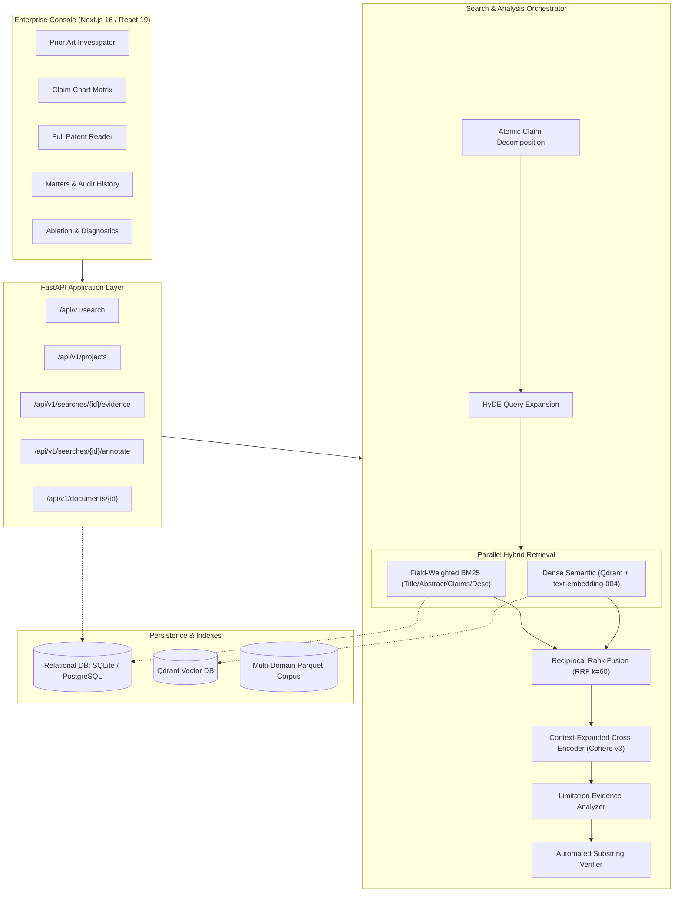

# Enterprise Patent Intelligence & Prior-Art Research Platform

[](https://github.com/mishrasarthak08/Patent-Prior-Art-Search-Engine/actions/workflows/ci_full_gate.yml)
[](https://www.python.org/downloads/release/python-3120/)
[](https://nextjs.org/)
[](https://fastapi.tiangolo.com)
[](https://qdrant.tech/)
[](https://github.com/astral-sh/ruff)
[](http://mypy-lang.org/)

An enterprise-grade, hybrid-retrieval, and evidence-grounded patent intelligence platform for patent attorneys, patent examiners, and corporate IP research teams.

The platform decomposes complex patent claims into atomic limitation trees, performs parallel field-weighted lexical and dense vector search with metadata filtering, fuses results via Reciprocal Rank Fusion (RRF), applies full-disclosure cross-encoder reranking, and synthesizes verifiable claim charts with automated substring quotation verification against authoritative patent texts.

---

## 🏛 Platform Architecture



---

## ✨ Key Enterprise Capabilities

1. **Traceable Claim Limitation Decomposition**: Parses raw patent claims into preamble, transition, and limitation elements with exact character offsets (`start_char`, `end_char`), preserved verbatim legal terminology, and fallback AST parsing under LLM rate limits.
2. **True Hybrid Retrieval with Legal Metadata Filtering**:
   - Field-weighted BM25 evaluating Title ($\times 3.0$), Abstract ($\times 2.0$), Claims ($\times 2.0$), and Description ($\times 1.0$).
   - Dense vector retrieval via Qdrant with native metadata push-down filters for CPC classification prefixes, publication date ranges, jurisdictions, and patent family deduplication.
3. **Full-Disclosure Cross-Encoder Context Expansion**: Expands candidate snippets to 1,500-character disclosure windows before Cohere v3 cross-encoder scoring to eliminate false negatives from truncated snippets.
4. **Verifiable Claim Chart Engine**: Evaluates evidence at the limitation level (`DIRECTLY_SUPPORTED`, `PARTIALLY_SUPPORTED`, `RELATED_DISCLOSURE`, `NOT_FOUND`) with automated substring quotation verification against full patent disclosures.
5. **Durable Relational Persistence**: Built on SQLAlchemy ORM (SQLite / PostgreSQL) to manage legal matters, query histories, attorney annotations, and versioned evaluation benchmarks.
6. **Scientific IR Evaluation Harness**: Built-in benchmark suite evaluating 5 pipeline variants (BM25 Only, Dense Only, Hybrid RRF, Hybrid Rerank, Full Pipeline) on NDCG@10, MAP@10, Recall@10, and MRR.
7. **Production Next.js 16 Workspace**: 5 specialized tabs:
   - **Investigator**: Advanced search with interactive claim breakdown and real-time execution profiling.
   - **Claim Chart & Evidence**: Side-by-side limitation-to-prior-art mapping with verification badges and confidence meters.
   - **Patent Reader**: Complete multi-section viewer (Abstract, Claims, Description) with attorney annotation toolbar.
   - **Matters & History**: Prior art search audit trail with persistence.
   - **Ablation & Diagnostics**: Visual benchmarking radar and component ablation lift tables.

---

## 📂 Repository Structure

```text
├── backend/
│   ├── app/
│   │   ├── config.py                 # Pydantic Settings & environment validation
│   │   ├── main.py                   # FastAPI REST API endpoints
│   │   ├── schemas.py                # Pydantic data contracts (ClaimElement, Evidence, etc.)
│   │   ├── db/                       # Relational persistence layer
│   │   │   ├── models.py             # SQLAlchemy models (Project, PatentDocument, etc.)
│   │   │   └── session.py            # Database engine & session maker
│   │   ├── corpus/                   # Ingestion & multi-domain patent loader
│   │   │   └── corpus_loader.py      # Multi-domain seed patents & parquet generator
│   │   └── retrieval/                # Search & AI orchestrator
│   │       ├── bm25_retriever.py     # Field-weighted BM25 with metadata filters
│   │       ├── dense_retriever.py    # Qdrant semantic vector search
│   │       ├── fusion.py             # Reciprocal Rank Fusion (RRF)
│   │       ├── reranker.py           # Cohere Cross-Encoder with window expansion
│   │       ├── evidence_analyzer.py  # Claim chart analyzer & quotation verifier
│   │       ├── explain.py            # Grounded summary synthesizer
│   │       ├── query_understanding.py# Atomic claim decomposition & HyDE
│   │       └── graph.py              # LangGraph parallel state orchestrator
│   ├── Dockerfile                    # Production backend container
│   └── requirements.txt              # Production Python dependencies
├── frontend/                         # Next.js 16 + React 19 + Tailwind UI
│   ├── src/app/page.tsx              # 5-Tab Enterprise Console
│   └── package.json
├── data/
│   ├── corpus/corpus.parquet         # Seeded multi-domain patent dataset
│   └── patent_platform.db            # SQLite relational database
├── eval/
│   ├── benchmark_dataset.json        # Curated multi-domain evaluation benchmark
│   └── results/lift_table.csv        # Persisted ablation comparison metrics
├── tests/
│   ├── eval/                         # Evaluation harness & ablation runner
│   │   ├── harness.py
│   │   └── run_eval.py
│   ├── test_api.py                   # API endpoint tests
│   ├── test_enterprise_platform.py   # Relational persistence & filter tests
│   ├── test_explain.py               # Evidence explanation tests
│   ├── test_phase6_hardening.py      # Hardening & error handling tests
│   ├── test_query_understanding.py   # Claim decomposition tests
│   └── test_retrieval.py             # Retrieval & reranker tests
├── docker-compose.yml                # Multi-service local composition
└── pyproject.toml                    # Ruff & Mypy configurations
```

---

## 🚀 Getting Started

### Prerequisites
- Python 3.12+
- Node.js 20+
- (Optional) Docker & Docker Compose

### 1. Environment Setup
Create a `.env` file in the root directory:
```bash
cp .env.example .env
```
Key configuration variables:
```ini
# Security & Persistence
API_AUTH_TOKEN=""                      # Optional Bearer token for API protection
DATABASE_URL="sqlite:///./data/patent_platform.db"
CONFIDENTIAL_MODE="true"               # Enforce zero data retention / no-training flags

# External AI Providers (Optional — system falls back gracefully if unset)
GOOGLE_API_KEY="your-gemini-key"
COHERE_API_KEY="your-cohere-key"

# Vector Search Engine
QDRANT_URL="http://localhost:6333"
QDRANT_COLLECTION="patents"
```

### 2. Local Backend Execution
```bash
# Set up virtual environment and install dependencies
uv venv --python 3.12 .venv
source .venv/bin/activate
uv pip install -r backend/requirements.txt -r tests/requirements-test.txt

# Seed the database and multi-domain corpus
python -m backend.app.corpus.corpus_loader

# Run the FastAPI server
uvicorn backend.app.main:app --host 0.0.0.0 --port 8000 --reload
```

### 3. Local Frontend Execution
```bash
cd frontend
npm install
npm run dev
```
Access the application at `http://localhost:3000`.

### 4. Running with Docker Compose
To launch the complete enterprise stack (FastAPI Backend + Qdrant Vector Engine + Next.js Frontend):
```bash
docker compose up -d --build
```

---

## 🧪 Testing, Quality Gates & Benchmarks

The project enforces zero-compromise quality gates:

```bash
# Run the complete test suite (23 passing tests)
pytest tests/

# Execute static type checking (0 errors across 20 source files)
mypy backend/app

# Run Ruff linter and code formatter
ruff check .
ruff format --check .

# Run the scientific retrieval evaluation suite
python tests/eval/run_eval.py
```

---

## ⚖️ Statutory Legal Notice

> **IMPORTANT**: This software is an automated decision-support research engine designed to identify potentially relevant technical literature. It does **NOT** provide legal advice, patentability determinations, infringement analyses, or formal Freedom-to-Operate (FTO) clearances. All claims, citations, and evidence charts produced by this system must be independently reviewed and verified by a qualified, registered patent attorney or patent agent.
