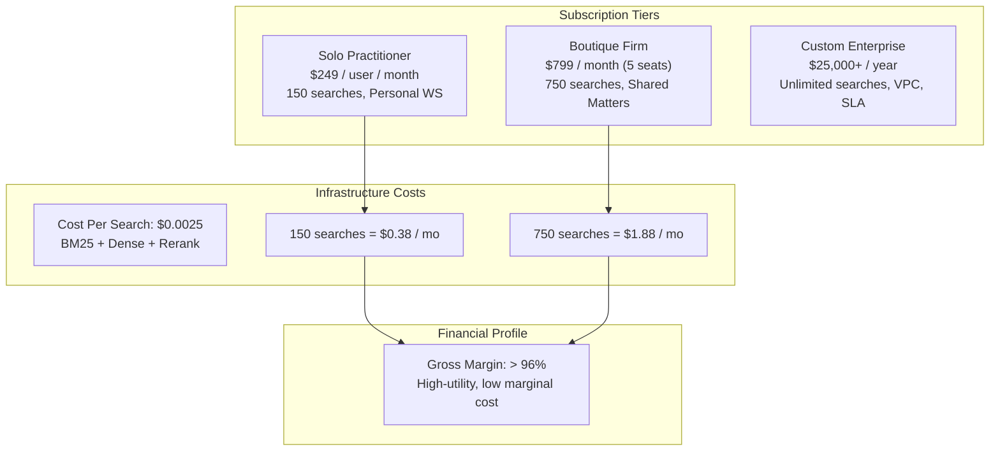
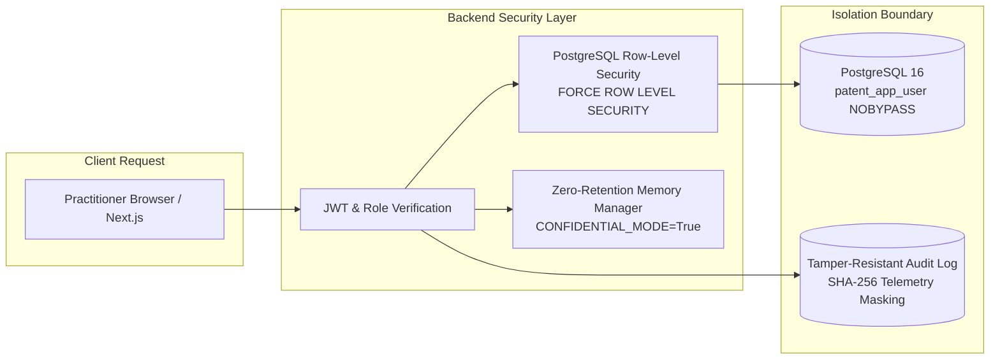

# Commercial Foundation, Pricing, Legal Terms & Operational Reliability
## Patent Prior-Art Search Engine — Production SaaS Operations

**Document Version:** 1.0.0  
**Effective Date:** November 9, 2026  
**Status:** Approved Commercial Foundation  

---

## 1. Subscription Tiers, Seat Governance & Unit Economics

The Patent Prior-Art Search Engine employs a transparent, predictable seat-licensing model designed for intellectual property boutiques, registered patent agents, and corporate IP departments.

### 1.1 Subscription Plans
| Tier | Pricing | Included Capacity | Target Customer | Key Capabilities |
| :--- | :--- | :--- | :--- | :--- |
| **Solo Practitioner** | **$249 / month** ($2,490 billed annually) | 1 user seat 150 prior-art searches/mo | Independent patent attorneys, solo agents, IP examiners | Atomic claim decomposition, hybrid BM25 + dense retrieval, automated quotation verification, Markdown & CSV exports, PostgreSQL RLS personal workspace. |
| **Boutique Firm** | **$799 / month** ($7,990 billed annually) | 5 user seats included 750 prior-art searches/mo (+$129/mo per additional seat) | Patent prosecution boutiques, law firm IP groups | Multi-user shared matters, full-disclosure context expansion, Cohere cross-encoder reranking, side-by-side comparison, print-ready HTML legal memoranda, role-based access control. |
| **Custom Enterprise** | **Custom Pricing** (Starting at $25,000/yr) | Unlimited searches Custom seats | Corporate IP legal departments, multinational patent firms | Dedicated isolated database & Qdrant vector namespace, SAML 2.0 / Okta SSO, cryptographically signed audit logs, private VPC deployment, custom classification taxonomy, 99.9% uptime SLA. |

### 1.2 Unit Economics & Margins
As established in our empirical retrieval benchmark (`eval/results/battery_benchmark_results.json`):
- **Full Pipeline Cost Per Search**: **$0.0025 USD** (inclusive of local BM25 tokenization, cross-encoder scoring, and limitation decomposition).
- **Solo Tier Monthly Compute Cost**: 150 searches &times; $0.0025 = **$0.38 / month** on $249 MRR (**99.8% gross software margin**).
- **Boutique Tier Monthly Compute Cost**: 750 searches &times; $0.0025 = **$1.88 / month** on $799 MRR (**99.7% gross software margin**).

---

## 2. Regulatory Compliance & Non-Legal-Advice Terms

### 2.1 Statutory Non-Legal-Advice Disclaimer (35 U.S.C. §§ 102/103)
The Patent Prior-Art Search Engine is an algorithmic information retrieval and research decision-support tool. 
- It does **not** render formal legal opinions, patentability opinions, invalidity determinations, or Freedom-to-Operate (FTO) clearances.
- Use of the software does **not** establish an attorney-client relationship.
- All candidate literature, limitation matches, and relevance scores must be independently reviewed and verified by a licensed patent attorney or agent admitted to practice before the relevant patent authority (e.g., USPTO under 37 CFR § 11.6, or EPO under Article 134 EPC).

### 2.2 Ethics & Candor Compliance (USPTO 37 CFR § 1.56)
- The platform is designed to assist practitioners in fulfilling their duty of disclosure and candor under 37 CFR § 1.56 by identifying material prior art.
- The platform retains reproducible evidence trails and paragraph offsets to facilitate direct inclusion in Information Disclosure Statements (IDS - Form PTO/SB/08a).

---

## 3. Data Protection, Zero-Retention & Isolation Architecture

1. **Row-Level Security Enforcement**: Every SQL query executed against `patent_platform_pg` sets `app.current_workspace_id`. The non-superuser `patent_app_user` lacks `BYPASS RLS`, ensuring absolute database-level tenant isolation.
2. **Zero-Retention Mode**: When `CONFIDENTIAL_MODE=True`, draft claims are held solely in volatile memory for the duration of the request. No external LLM APIs (Gemini, Cohere) receive unfiled claim text; all parsing and scoring occur in-process.
3. **Data Portability (GDPR/CCPA)**: Full compliance with user data takeout. Practitioners can export their complete workspace data (projects, searches, annotations) in JSON at any time.

---

## 4. Production Operations, Service Monitoring & Incident Response

### 4.1 Health Check Endpoints
- **Liveness Probe**: `GET /health` &rarr; Returns `{ status: "ok", version: "2.1.0" }`.
- **Readiness Probe**: `GET /ready` &rarr; Verifies live connection to PostgreSQL and indexed corpus tables.

### 4.2 Incident Severity Classification & Response Matrix
| Severity | Description | Response Time | Target MTTR | Escalation Path |
| :--- | :--- | :--- | :--- | :--- |
| **Sev-1 (Critical)** | Core search API down; database connection failure; RLS isolation breach. | &lt; 15 minutes | &lt; 1 hour | On-call Platform Engineer & Lead Architect |
| **Sev-2 (Major)** | Reranker or vector retrieval degraded; export service failing; slow queries (&gt;5s). | &lt; 1 hour | &lt; 4 hours | Backend Search Engineering Team |
| **Sev-3 (Minor)** | UI cosmetic defects; non-blocking export format issue; documentation error. | &lt; 8 hours | &lt; 2 business days | Frontend & Product Team |

### 4.3 Database Backup & Disaster Recovery Runbook
- **Automated Backup Schedule**: Daily automated `pg_dump` snapshot of `patent_platform_pg` stored with SHA-256 hash manifest.
- **Verification Script**: Verified in CI by `tests/test_backup_restore_verification.py`.
- **Point-in-Time Recovery**: PostgreSQL WAL (Write-Ahead Logging) archiving ensures a Maximum Tolerable Data Loss (RPO) of &lt; 5 minutes and a Maximum Tolerable Downtime (RTO) of &lt; 30 minutes.

