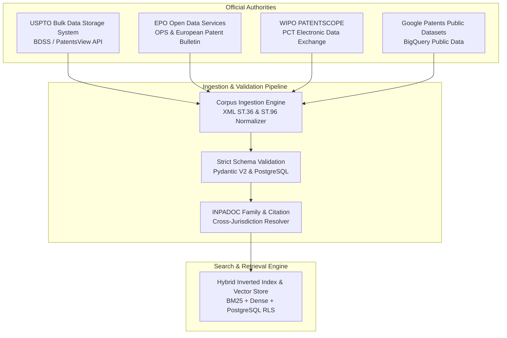
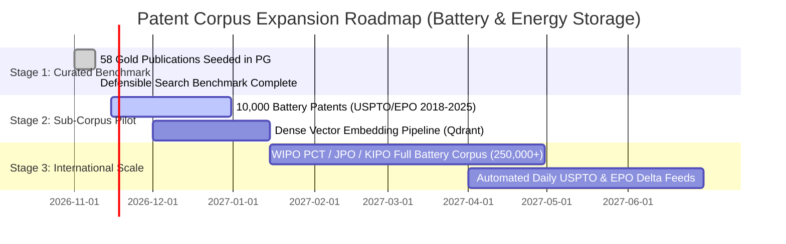

# Patent Corpus Provenance, Legal Licensing & Technical Expansion Roadmap
## Battery & Energy Storage Technology Sector (CPC H01M, Y02E 60/10)
### Patent Prior-Art Search Engine — Data Engineering Specification

**Document Version:** 1.0.0  
**Effective Date:** November 9, 2026  
**Status:** Approved Technical Architecture  

---

## 1. Permitted, Official Data Sources & Legal Compliance

The Patent Prior-Art Search Engine adheres strictly to official, authorized, and non-proprietary public patent sources. It rejects any scraping of paywalled commercial systems or unverified third-party redistributors.

### 1.1 Legal Framework & Public Domain Status
1. **United States Patent Publications (USPTO)**:
   - Pursuant to **17 U.S.C. § 105** and **35 U.S.C. § 105**, publications of the United States Patent and Trademark Office (patents, patent application publications, reexamination certificates, and statutory invention registrations) are works of the United States Government and reside in the public domain.
   - Commercial ingestion, indexing, natural language processing, vector transformation, and caching of USPTO text and drawings carry no copyright restriction.
2. **European Patent Office (EPO)**:
   - Ingestion is conducted in accordance with the **EPO Open Data Policy** and the European Patent Bulletin terms.
   - Bibliographic data, abstracts, descriptions, and claims published under the European Patent Convention are non-exclusive public legal instruments.
3. **World Intellectual Property Organization (WIPO)**:
   - Published PCT applications (Article 21 PCT) are distributed for public notification under the Patent Cooperation Treaty Regulations (Rules 48 and 86).
   - Ingestion utilizes bulk electronic feeds in compliance with WIPO Data Dissemination guidelines.

---

## 2. Technical Ingestion Architecture

### 2.1 Standardized Document Normalization
All incoming raw records are parsed from WIPO Standard **ST.36** and **ST.96** XML structures into the canonical `PatentDocument` domain model:

| Field | Source Mapping | Transformation & Cleansing Rule |
| :--- | :--- | :--- |
| `id` | Patent Publication Number | Strips punctuation, preserves standard WIPO country code + publication serial + Kind Code (e.g., `US10930920B2`, `EP3787071A1`). |
| `country` | Country / Office Code | 2-letter ISO 3166-1 alpha-2 / WIPO ST.3 code (`US`, `EP`, `WO`, `JP`, `KR`, `CN`). |
| `title` | Title of the Invention | Unescapes XML entities, normalizes whitespace and chemical formulae. |
| `abstract` | Abstract of the Disclosure | Strips leading paragraph tags, normalizes Unicode superscripts/subscripts. |
| `description_text` | Detailed Description | Preserves technical paragraph numbering (`[0012]`), isolates background, summary, and embodiment sections. |
| `claims_list` | Claims Section | Strict parsing into ordered array of discrete claim elements; isolates independent claims from dependent claim trees. |
| `cpc_codes` | CPC Classification | Standardizes section, class, subclass, group, and subgroup identifiers (e.g., `H01M 4/134`, `H01M 10/0525`). |
| `filing_date` / `publication_date` | Date of Filing / Grant | ISO 8601 `YYYY-MM-DD` date validation. |
| `assignee` / `inventor` | Applicant / Inventor Names | Corporate hierarchy normalization (e.g., "Tesla, Inc." vs "TESLA INC"). |
| `cited_patents` | Backward Citations | Citation graph edge generation for network-based prior-art exploration. |
| `family_id` | INPADOC Patent Family | Unifies simple and extended patent families across international filings. |

---

## 3. Battery & Energy Storage Sub-Corpus Profile

The platform's initial focused vertical is **Battery & Energy Storage Technologies**. Prior-art searches in this field frequently fail in traditional keyword engines due to dense chemical terminology, stoichiometric variants, and functional claim language.

### 3.1 Primary CPC Classification Targets
- **H01M 4/00 – H01M 4/98**: Electrodes (active materials, binders, conductive additives, current collectors, silicon-carbon composites, solid-state composite cathodes).
- **H01M 10/00 – H01M 10/667**: Secondary cells, lithium-ion, sodium-ion, solid-state batteries, thermal management systems, fast-charging protocols.
- **H01M 50/00 – H01M 50/70**: Structural casings, venting mechanisms, separator membranes, cell-to-pack architectures, safety shutdown mechanisms.
- **Y02E 60/10**: Climate change mitigation technologies relating to electrochemical energy storage systems.
- **C01B 25/00 – C01B 25/45**: Lithium iron manganese phosphate (LMFP), phospho-olivines, and related inorganic compounds.

### 3.2 Key Target Technology Clusters
1. **Silicon & Silicon-Carbon Composite Anodes**: Volume expansion mitigation, pre-lithiation strategies, polymer binders (PAA, CMC, alginate), porous carbon matrix scaffolds.
2. **Solid-State Electrolytes & Solid-State Batteries**: Sulfide-based solid electrolytes (LGPS, argyrodite), oxide-based electrolytes (LLZO, NASICON), polymer-ceramic composite separators.
3. **High-Voltage / High-Capacity Cathodes**: Ultra-high nickel NMC (Ni &ge; 90%), single-crystal NMC, lithium manganese iron phosphate (LMFP), cobalt-free spinel materials.
4. **Fast-Charging & Thermal Management**: Dual-phase immersion cooling, multi-stage constant-current constant-voltage algorithms, low-temperature heating circuits.

---

## 4. Multi-Stage Expansion Roadmap

### 4.1 Stage 1: Curated 58-Publication Gold Benchmark (Current Production State)
- **Status**: Completed and fully indexed in PostgreSQL `patent_platform_pg`.
- **Composition**: 58 representative publications spanning US, EP, and WO jurisdictions.
- **Scope**: Covers foundational and next-generation battery IP from CATL, Tesla, QuantumScape, Panasonic, Sila Nanotechnologies, LG Energy Solution, and Solid Power.
- **Purpose**: Powers reproducible evaluation benchmarks (`eval/battery_benchmark_dataset.json`), zero-defect claim decomposition, and evidence quotation verification.

### 4.2 Stage 2: 10,000-Patent Sub-Corpus Ingestion (Q4 2026 – Q1 2027)
- **Scope**: 10,000 utility patents and published applications granted between 2018 and 2025 under CPC H01M4, H01M10, and H01M50.
- **Source**: USPTO Patent Grant Full Text Data (BDSS XML) and EPO Open Patent Services (OPS).
- **Storage**: PostgreSQL 16 on managed NVMe storage with full Row-Level Security; Qdrant vector index for 768-dimensional local embeddings.
- **Throughput Target**: 500 documents/minute batch ingestion with automated citation graph and claim element parsing.

### 4.3 Stage 3: Full International Energy Storage Corpus (Q2 2027)
- **Scope**: Over 250,000 battery and energy storage patent publications worldwide (US, EP, WO, JP, KR, CN).
- **Capabilities**: Automated nightly delta synchronization via USPTO Electronic Bulk feeds and EPO weekly Bulletin releases.
- **High-Availability**: Multi-region read replicas with tenant-isolated analytical caching.

