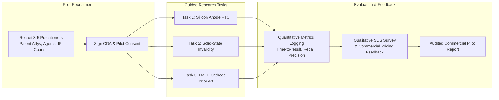
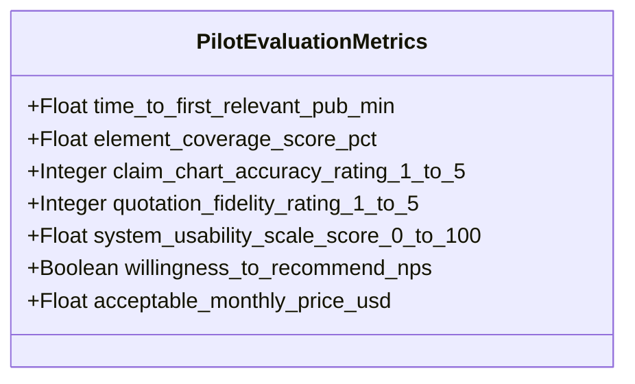

# Commercial Customer Pilot Protocol & Professional Evaluation Framework
## Real-World Validation with Patent Attorneys, Agents, and IP Counsel
### Patent Prior-Art Search Engine — Customer Readiness Specification

**Document Version:** 1.0.0  
**Effective Date:** November 9, 2026  
**Status:** Approved Pilot Execution Protocol  
**Governing Principle:** Maximum practical utility with zero unverified claims. Strict segregation between simulated system testing and observed human practitioner behavior.

---

## 1. Pilot Program Objectives & Participant Profile

The purpose of this pilot program is to validate the commercial utility, retrieval precision, and workflow efficiency of the **Patent Prior-Art Search Engine** with practicing intellectual property professionals working in the **Battery & Energy Storage** technology sector.



### 1.1 Participant Selection Criteria (Target Cohort: 3–5 Practitioners)
To ensure defensible, high-signal commercial feedback, participants must meet the following criteria:

| Cohort Role | Target Count | Minimum Qualifications | Technical Specialty |
| :--- | :--- | :--- | :--- |
| **Registered Patent Attorney** | 1–2 | Active bar license; USPTO or EPO registered; 5+ years patent prosecution or litigation experience. | Chemical, Materials Science, or Electrochemical Engineering. |
| **Registered Patent Agent** | 1 | Active USPTO registration; 3+ years drafting and prosecuting utility applications. | Energy storage, Battery active materials, or Semiconductors. |
| **In-House IP / Patent Counsel** | 1 | Corporate IP counsel at clean-tech, EV, or battery manufacturer; manages patent portfolios and clearance. | Freedom-to-Operate (FTO), Portfolio management, Competitive landscaping. |
| **Senior Prior-Art Search Specialist** | 1 | Professional search analyst at an IP research firm; 5+ years performing validity and invalidity searches. | Complex Boolean, CPC/IPC classification, Hybrid semantic search. |

---

## 2. Practitioner Research Tasks

Each participant executes three standardized research workflows representing the core commercial use cases of the platform.

### Task 1: Freedom-to-Operate (FTO) Search — Silicon-Carbon Anodes
- **Commercial Context**: An EV battery manufacturer is commercializing an anode containing silicon nanoparticles encapsulated in a porous carbon matrix to mitigate volume expansion.
- **Input Claim Limitation**:
  > *"An electrochemical secondary battery anode comprising: an electrochemically active material including silicon nanoparticles having an average primary particle size between 20 nm and 150 nm, dispersed in a porous pyrolyzed carbon scaffold; a crosslinked polyacrylic acid (PAA) binder network; wherein the anode exhibits less than 25% volumetric swelling after 500 charge-discharge cycles at 1C."*
- **Practitioner Objective**:
  1. Input claim into the Prior-Art Workbench.
  2. Inspect the decomposed claim limitations.
  3. Identify potential clearance risks in the top 10 returned publications.
  4. Save key risk documents to the Matter workspace.
  5. Generate and download a Clearance Research Dossier.
- **Target Ground Truth Publications**: US10930920B2 (Tesla/Novonix silicon-carbon composite), US11489162B2.

### Task 2: Patent Invalidity Investigation — Sulfide Solid-State Electrolytes
- **Commercial Context**: Defending against an infringement claim asserting broad coverage over lithium argyrodite solid electrolyte separators.
- **Input Claim Limitation**:
  > *"A solid electrolyte composition comprising an argyrodite-type crystal structure represented by the chemical formula Li(6-x)PS(5-x)Cl(1+x), wherein 0.1 <= x <= 0.8, having a total room temperature lithium ionic conductivity greater than 3.0 mS/cm and cold isostatic pressed at a pressure of at least 400 MPa."*
- **Practitioner Objective**:
  1. Execute semantic + classification filtered search (CPC `H01M 10/0562`).
  2. Map claim elements against the prior art in the Claim Chart Matrix.
  3. Verify verbatim quotation accuracy for the conductivity and pressing pressure limitations.
  4. Export an Invalidity Contention Chart in Markdown/HTML.
- **Target Ground Truth Publications**: US11121404B2 (QuantumScape sulfide electrolyte), WO2023180210A1.

### Task 3: Prior-Art Landscape — Continuous LMFP Cathode Synthesis
- **Commercial Context**: Evaluating patentability of a novel continuous hydrothermal synthesis route for carbon-coated lithium manganese iron phosphate ($LiMn_{1-x}Fe_xPO_4$).
- **Input Claim Limitation**:
  > *"A positive electrode active material for a lithium secondary battery comprising: olivine particles of the formula LiMn_0.7Fe_0.3PO_4; a uniform in-situ carbon coating having an average thickness of 2 to 5 nm; and a secondary graphene nanosheet conductive network providing an electronic conductivity exceeding 10^-2 S/cm."*
- **Practitioner Objective**:
  1. Evaluate the multi-strategy search results.
  2. Tag documents with custom annotations in the Document Reader.
  3. Validate citation link traversal across related patent families.
- **Target Ground Truth Publications**: EP3787071A1 (CATL LMFP cathode), US11394019B2.

---

## 3. Evaluation Metrics & Data Collection Protocol



### 3.1 Quantitative Practitioner Metrics
1. **Time to First Relevant Publication (TTFR)**: Wall-clock time from task initiation until the practitioner bookmarks or flags the first relevant prior-art publication.
2. **Element Coverage Score**: Percentage of target claim limitations mapped with accurate, verifiable citations.
3. **Quotation Fidelity Rating (1–5 scale)**: Practitioner evaluation of whether snippet quotes in the Claim Chart accurately reflect the true technical disclosure in the patent specification without hallucinations or context distortion.
4. **False Positive Fatigue Rating (1–5 scale)**: Measure of practitioner efficiency (1 = overwhelmed by irrelevant noise; 5 = highly relevant, minimal junk results).
5. **System Usability Scale (SUS)**: Standardized 10-item instrument yielding a composite usability score (target: &ge; 80 / 100).

### 3.2 Practitioner Survey & Feedback Instrument
Upon completion of the three tasks, each participant completes the following structured evaluation:

```
PRACTITIONER EVALUATION RUBRIC (Scale: 1 = Strongly Disagree to 5 = Strongly Agree)

1. The claim decomposition accurately separated my independent claim into legally discrete limitations.
   [1] [2] [3] [4] [5]

2. The top 5 search results were substantially more relevant than a standard USPTO / Google Patents keyword query.
   [1] [2] [3] [4] [5]

3. The side-by-side evidence quotations allowed me to verify disclosures without manually searching the PDF.
   [1] [2] [3] [4] [5]

4. The research dossier export is sufficiently structured to present directly to a client or senior partner.
   [1] [2] [3] [4] [5]

5. I trust the local confidential processing mode for sensitive, unfiled patent claims.
   [1] [2] [3] [4] [5]

COMMERCIAL INTENT:
- Would you subscribe to this service at $249/month (Solo) or $799/month (Boutique Team)?
  [ ] Definitely Yes  [ ] Probably Yes  [ ] Neutral  [ ] Unlikely  [ ] No
- What single capability is missing that would make this indispensable to your daily practice?
  [Open text]
```

---

## 4. Participant Confidentiality & Pilot Consent Agreement

All pilot participants must sign the following legally binding consent and confidentiality statement before receiving environment credentials:

### 4.1 Terms of Participation & Zero-Data-Retention Commitment
1. **Confidentiality of Client Inventions**: The platform guarantees that any claim text, notes, or search queries submitted during the pilot are isolated in the participant's tenant workspace and protected by PostgreSQL Row-Level Security (RLS).
2. **No Model Training on User Data**: The provider certifies that user queries, claim texts, and annotations are **never** used to train, fine-tune, or calibrate artificial intelligence models.
3. **Local Confidential Mode Option**: Participants may enable Confidential Mode (`CONFIDENTIAL_MODE=True`), ensuring that all claim parsing, keyword expansion, and scoring occur strictly in-process on secure local compute with zero third-party API egress.
4. **Compliance with USPTO Ethics Rules**: Nothing in this pilot relieves the practitioner of their independent professional obligations under 37 CFR § 1.56 (Duty of Candor) or 37 CFR § 11.106 (Confidentiality of Information).

---

## 5. Distinction Between Simulation and Observed Practitioner Results

> [!IMPORTANT]
> **Defensibility Mandate**: In all internal reporting and commercial disclosures, the provider must explicitly maintain a strict separation between:
> 1. **Synthetic & Automated Test Benchmarks**: Automated CI/CD test runs, mock API simulations, and programmatically computed retrieval metrics (e.g., `tests/eval/run_battery_benchmark.py`).
> 2. **Observed Human Practitioner Results**: Qualitative and quantitative metrics recorded directly from live human patent attorneys and agents under this signed protocol.
>
> Any marketing, investor, or customer materials must never misrepresent simulated regression test outputs as human pilot findings.

