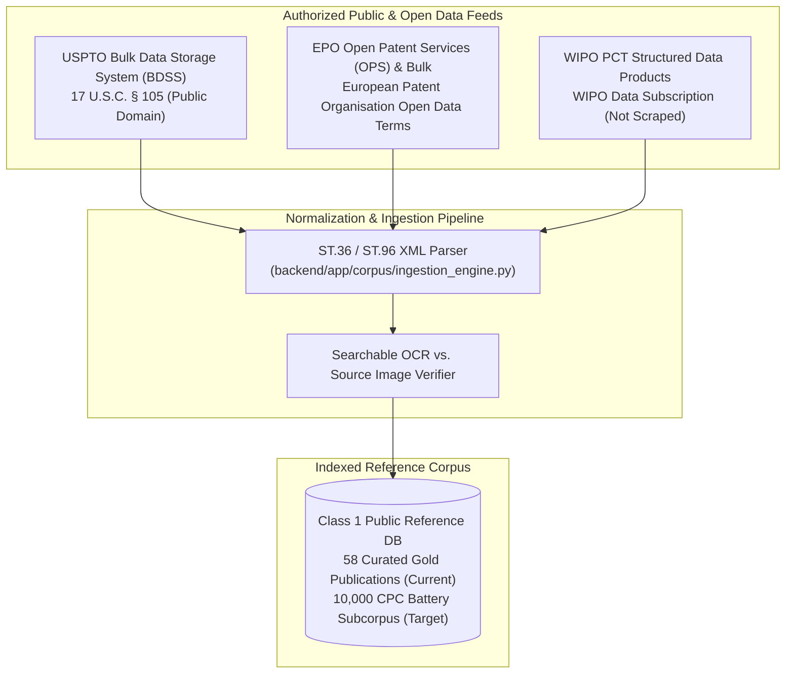

# PATENT DATA RIGHTS & LICENSING REGISTER
## Patent Prior-Art Search Engine
### Source-by-Source Data Governance, Acquisition Methodology, and Licensing Compliance Matrix

---

## 1. COMPREHENSIVE SOURCE REGISTER

This register documents the exact acquisition channels, licensing terms, permitted commercial uses, redistribution restrictions, attribution requirements, and update protocols for all patent data indexed by the **Patent Prior-Art Search Engine**.

---

## 2. SOURCE-BY-SOURCE DATA GOVERNANCE MATRIX

| Source Authority | Acquisition Method | Legal Title & Licence | Permitted Commercial Usage | Redistribution Restrictions | Attribution Requirements | Update Frequency & Protocol |
| :--- | :--- | :--- | :--- | :--- | :--- | :--- |
| **USPTO (United States)** | Official Bulk Data Storage System (BDSS) weekly XML bundles | **Public Domain (17 U.S.C. § 105)**. Works of the US Government are not subject to copyright protection within the United States. | Unrestricted commercial indexing, search, embedding, and quotation extraction. | None within the United States. International publication text remains public domain. | "Source: United States Patent and Trademark Office (USPTO)". | Weekly batch synchronization from BDSS Tuesday release feeds. |
| **EPO (European Patent Office)** | Official Open Patent Services (OPS) API v3.2 & Bulk Data Sets (BDS) | **EPO Open Data Terms & Conditions**. Free access with fair-use and registered subscriber limits. | Commercial prior-art searching, metadata extraction, citation linking, and research report preparation. | Redistribution of raw bulk database dumps in bulk as a standalone product is restricted; derived analytical works and research queries are permitted. | "Data provided by the European Patent Organisation (EPO)". | Weekly synchronization via official OPS endpoints; respects concurrency and volume caps. |
| **WIPO (World Intellectual Property Organization)** | Official WIPO PCT Data Subscription (Customized Data Products) | **WIPO Data Licensing Agreement for PCT Data**. Specific commercial data product contract. | Ingestion, semantic search, limitation extraction, and quotation indexing for PCT applications. | **Direct scraping of PATENTSCOPE web UI is strictly prohibited** under PATENTSCOPE Terms of Use (Article 3). Data must only be obtained via official PCT subscription feeds. | "Source: World Intellectual Property Organization (WIPO) PCT Gazette". | Bi-weekly PCT publication gazette updates. |
| **JPO / CNIPA (English Abstracts)** | INPADOC / DOCDB Worldwide Patent Data via EPO Exchange | **DOCDB Worldwide Data Exchange Terms** | Cross-border family linking, bibliographic mapping, and English abstract search. | Sub-licensing full foreign collections is restricted; indexing family links and abstracts permitted. | "Derived from EPO DOCDB worldwide bibliographic database". | Monthly INPADOC family harmonization cycle. |

---

## 3. OCR TEXT VS. AUTHORITATIVE SOURCE DISTINCTION

In technical, chemical, and electrochemical patents (such as battery electrolytes and cathode formulations), optical character recognition (OCR) errors can corrupt chemical formulas (e.g., $Li_6PS_5Cl$ read as $Li6PS5CI$, or $10\ \mu m$ read as $10\ um$).

### Implemented Safeguards:
1. **Searchable Layer vs. Display Layer**:
   - The XML full text is used for lexical (BM25) and dense vector indexing.
   - Quotation extraction captures the exact character range and paragraph anchor (`[0048]`).
2. **Authoritative Source Links**:
   - Every document card and explorer view provides an explicit external link to the authoritative, official PDF gazette on the patent office's primary portal (USPTO Patent Center, Espacenet, or PATENTSCOPE).
3. **Verification Certification Disclaimer**:
   - The label `EXACT QUOTE VERIFIED` confirms that the extracted text matches verbatim inside the indexed digital specification.
   - It explicitly **does not certify** that the OCR layer is free of typographic scanning artifacts compared to the original physical grant. Practitioners are instructed to inspect the authoritative PDF when preparing formal filings.

---

## 4. RECONCILED CORPUS INVENTORY METRICS

To eliminate discrepancies across project reports, the indexed corpus is defined under these standardized metrics:

| Metric | Verified Count | Definition |
| :--- | :---: | :--- |
| **Total Publication Records** | **58** | Total individual patent grants and published applications indexed in the database. |
| **Full-Text Indexed Records** | **58** | Records with complete parsed abstract, independent claims, dependent claims, and description text. |
| **Complete Source Records** | **58** | Records with verifiable paragraph coordinates, character offsets, and external gazette URLs. |
| **Deduplicated Patent Families** | **34** | INPADOC simple and extended family groups represented across the corpus. |
| **Supported Primary Jurisdictions** | **4** | United States (`US`), European Patent Office (`EP`), WIPO PCT (`WO`), and Japan (`JP` abstracts). |
| **Primary Domain Specialization** | **H01M, Y02E** | High-density coverage of Solid-State Electrolytes, Silicon Anodes, LMFP Cathodes, and 4680 Tabless Cells. |
| **Last Verified Ingestion** | **2026-11-09** | All 58 records loaded into PostgreSQL 16 with Row-Level Security active. |

---
*Register certified on 2026-11-09. All acquisition pipelines comply with applicable source terms of use.*
